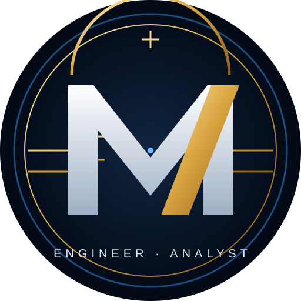

# Mohamed Amine
### Industrial Engineer · Data Analytics · Artificial Intelligence

**Engineering Ideas · Building Solutions · Pursuing Knowledge**

[About](#-about-me) · [Focus](#-areas-of-focus) · [Skills](#-technical-toolkit) · [Approach](#-how-i-work) · [Stats](#-github-activity) · [Connect](#-connect)

---

## 👨‍💻 About Me

I am an Industrial Engineer interested in solving complex industrial problems through **process optimization, statistical methods, data analytics, and intelligent technologies**.

I combine engineering methodologies with software and data-driven approaches to develop practical, measurable, and scalable solutions.

## 🎯 Areas of Focus

| Domain | What interests me |
|---|---|
| **Industrial Engineering** | Production systems, process optimization, quality engineering, operational research |
| **Data Analytics** | Statistical analysis, data processing, visualization, predictive modeling |
| **Artificial Intelligence** | Machine learning, intelligent systems, AI applications in industry |
| **Process Automation** | Workflow automation, digital transformation, intelligent business processes |

## 🧰 Technical Toolkit

**Programming & Analysis**

**Statistics, Engineering & Automation**

## 🧭 How I Work

1. **Understand** the problem and its operational context.
2. **Measure** the current situation using reliable data.
3. **Analyze** with appropriate engineering and statistical methods.
4. **Develop** a practical solution or prototype.
5. **Validate** results and document the methodology.
6. **Share** reproducible work and lessons learned.

## 📊 GitHub Activity

  
  

  

## 🚀 Research & Development

This profile is my public workspace for documenting engineering projects, technical experiments, analytical methods, and research as they become ready to share.

**Current principle:** build carefully, test honestly, document clearly.

## 🤝 Connect

Interested in exchanging ideas or collaborating on industrial engineering, data analytics, artificial intelligence, and process automation?

- GitHub: [@MedAmineEss-eng](https://github.com/MedAmineEss-eng)

---

*Analyze deeply. Engineer thoughtfully. Build with purpose.*

